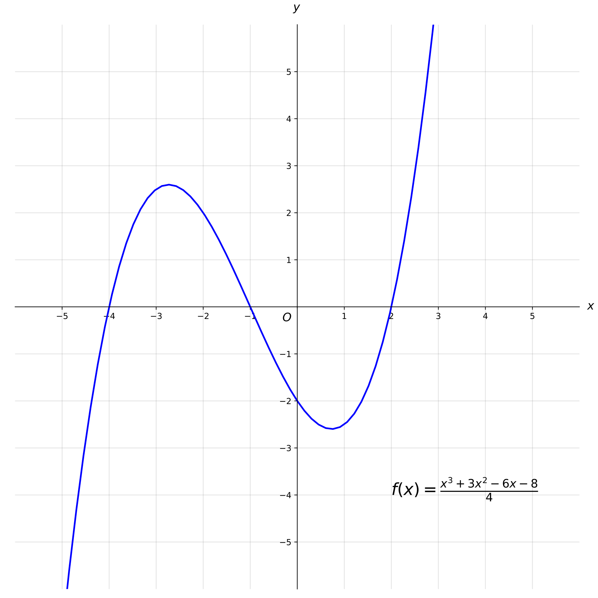
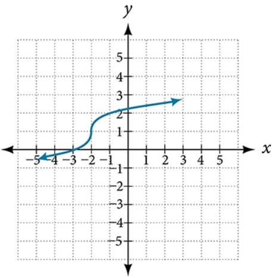

# AVP0458 — Single visual target

MathVista:167 / MathVerse:479 · same type · Mathematical roles of graphical elements

## Shared or similar visual information

A smooth principal curve on Cartesian axes

## Evidence locations

- Left image: The purple curve with a local maximum and minimum across the Cartesian axes.
- Right image: The increasing blue S-shaped curve across the Cartesian grid.

## Mathematical meanings

Left image: A function graph relating y to x. Right image: A function graph relating y to x.

## Same mathematical meanings

yes

## Rationales

Each curve uses horizontal input and vertical output positions to represent a function. Similar roles do not require the curves to be the same function.

Only the selected target is annotated. AI visual-review draft; not independently double-annotated by humans.
