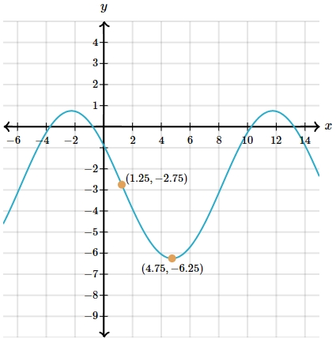

# AVP0459 — Single visual target

MathVista:308 / MathVerse:540 · same type · Mathematical roles of graphical elements

## Shared or similar visual information

An oscillating curve in a coordinate plot

## Evidence locations

- Left image: The blue oscillating curve extending across the horizontal axis scale.
- Right image: The cyan oscillating curve through the two orange coordinate markers.

## Mathematical meanings

Left image: A function graph relating vertical output to horizontal input. Right image: A function graph relating y to x.

## Same mathematical meanings

yes

## Rationales

Both drawings use repeating curves to represent y-versus-x behavior; the target is the graph role, not equality of the periods or formulas.

Only the selected target is annotated. AI visual-review draft; not independently double-annotated by humans.
