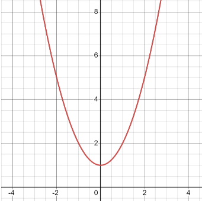
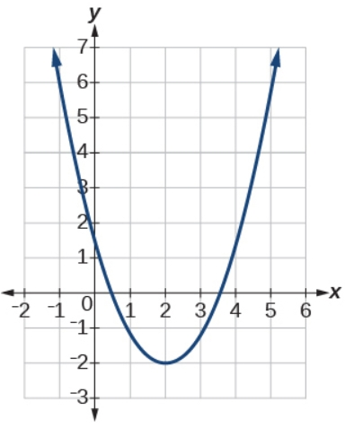

# AVP0460 — Single visual target

MathVista:346 / MathVerse:500 · same type · Mathematical roles of graphical elements

## Shared or similar visual information

A U-shaped curve in a coordinate grid

## Evidence locations

- Left image: The red U-shaped curve in the coordinate grid.
- Right image: The dark-blue U-shaped curve on a square coordinate grid.

## Mathematical meanings

Left image: A function graph relating y to x. Right image: A function graph relating y to x.

## Same mathematical meanings

yes

## Rationales

Both curves are principal function graphs on Cartesian axes. Their minima and scales differ, but the visual element represents the same kind of input-output correspondence.

Only the selected target is annotated. AI visual-review draft; not independently double-annotated by humans.
