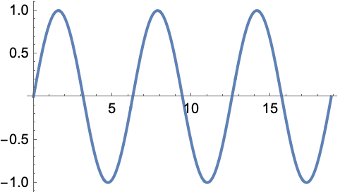

# AVP0461 — Single visual target

MathVista:409 / MathVista:308 · different type · Mathematical roles of graphical elements

## Shared or similar visual information

A smooth curved line in a coordinate diagram

## Evidence locations

- Left image: The blue closed circular outline centered on the coordinate origin.
- Right image: The blue oscillating curve extending across the horizontal axis scale.

## Mathematical meanings

Left image: The circumference of a geometric circle represented in a coordinate plane. Right image: A function graph relating vertical output to horizontal input.

## Same mathematical meanings

no

## Rationales

The closed curve is a circle circumference, while the open repeating curve represents a function graph. The axes alone do not make a circle into a single-valued y-function.

Only the selected target is annotated. AI visual-review draft; not independently double-annotated by humans.
