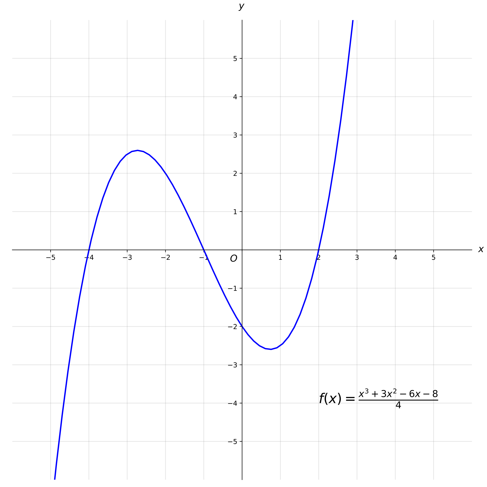

# AVP0462 — Single visual target

MathVista:767 / MathVista:167 · different type · Mathematical roles of graphical elements

## Shared or similar visual information

A smooth curved line in a coordinate diagram

## Evidence locations

- Left image: The closed circle labeled x^2+y^2=25.
- Right image: The purple curve with a local maximum and minimum across the Cartesian axes.

## Mathematical meanings

Left image: The circumference of a geometric circle represented in a coordinate plane. Right image: A function graph relating y to x.

## Same mathematical meanings

no

## Rationales

The equation x^2+y^2=25 identifies a closed geometric circle. The other curve represents a single-valued function across x; similar curvature does not establish the same local role.

Only the selected target is annotated. AI visual-review draft; not independently double-annotated by humans.
