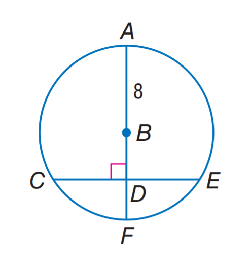
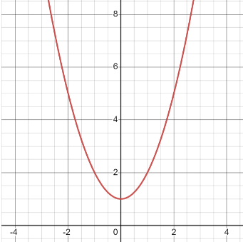

# AVP0464 — Single visual target

MathVista:804 / MathVista:346 · different type · Mathematical roles of graphical elements

## Shared or similar visual information

A smooth curved boundary or trace

## Evidence locations

- Left image: The blue circular outline through A, C, E and F.
- Right image: The red U-shaped curve in the coordinate grid.

## Mathematical meanings

Left image: The circumference bounding the geometric circle. Right image: A function graph relating y to x.

## Same mathematical meanings

no

## Rationales

The first curve is the closed boundary of a circle construction, while the second is a plotted y-function on a rectangular coordinate grid.

Only the selected target is annotated. AI visual-review draft; not independently double-annotated by humans.
