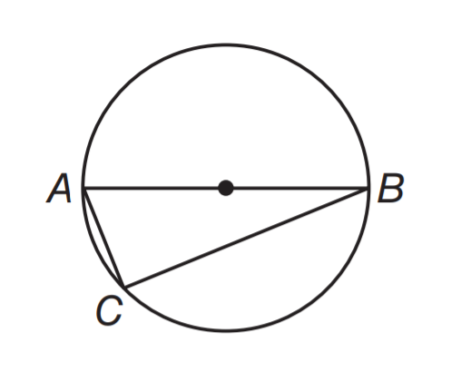
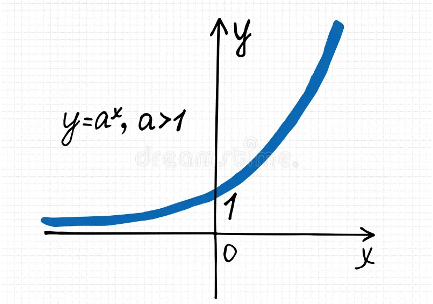

# AVP0465 — Single visual target

MathVista:28 / MathVista:39 · different type · Mathematical roles of graphical elements

## Shared or similar visual information

A smooth curved line

## Evidence locations

- Left image: The large unfilled circular outline surrounding A, B and C.
- Right image: The blue increasing curve next to the formula y=a^x, a>1.

## Mathematical meanings

Left image: The circumference of a geometric circle, rather than an excluded graph point. Right image: A function graph relating y to x.

## Same mathematical meanings

no

## Rationales

The curve through A and B is a full circle circumference associated with chords; the blue curve labeled y=a^x is a function graph.

Only the selected target is annotated. AI visual-review draft; not independently double-annotated by humans.
