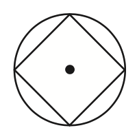
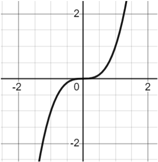

# AVP0466 — Single visual target

MathVista:82 / MathVista:120 · different type · Mathematical roles of graphical elements

## Shared or similar visual information

A smooth curved line

## Evidence locations

- Left image: The black circular outline surrounding the inscribed four-sided figure.
- Right image: The black S-shaped curve crossing the origin in the coordinate grid.

## Mathematical meanings

Left image: The circumference of the surrounding geometric circle. Right image: A function graph relating y to x.

## Same mathematical meanings

no

## Rationales

The black circular outline surrounds an inscribed polygon, while the S-shaped trace uses Cartesian positions to represent a y-function. Their roles come from the constructions, not the stroke color.

Only the selected target is annotated. AI visual-review draft; not independently double-annotated by humans.
