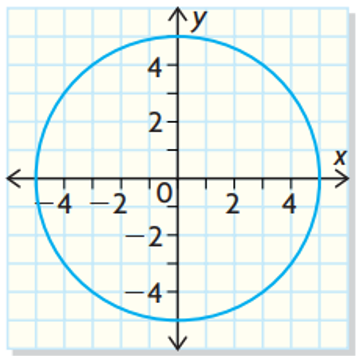

# AVP0467 — Single visual target

MathVista:409 / MathVerse:493 · different type · Mathematical roles of graphical elements

## Shared or similar visual information

A horizontal axis with tick labels

## Evidence locations

- Left image: The horizontal black axis through the circle center, labeled x at the right.
- Right image: The horizontal black x-axis crossing the V-shaped graph.

## Mathematical meanings

Left image: The horizontal coordinate axis that locates points by their x-coordinate. Right image: The horizontal coordinate axis used to read graph input coordinates.

## Same mathematical meanings

yes

## Rationales

Both lines establish the horizontal coordinate reference; a geometric circle on one and a V-shaped function on the other do not alter that axis role.

Only the selected target is annotated. AI visual-review draft; not independently double-annotated by humans.
