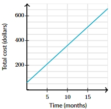

# AVP0468 — Single visual target

MathVista:767 / MathVerse:594 · different type · Mathematical roles of graphical elements

## Shared or similar visual information

A horizontal axis in a coordinate diagram

## Evidence locations

- Left image: The horizontal axis through the circle center, labeled x.
- Right image: The horizontal axis labeled Time (months).

## Mathematical meanings

Left image: The horizontal coordinate axis that locates points by their x-coordinate. Right image: The horizontal coordinate axis used to read the graph independent variable.

## Same mathematical meanings

yes

## Rationales

The selected line is the horizontal coordinate reference in both diagrams. Time is the explicit variable on the right; no equality between the coordinate quantities is asserted.

Only the selected target is annotated. AI visual-review draft; not independently double-annotated by humans.
