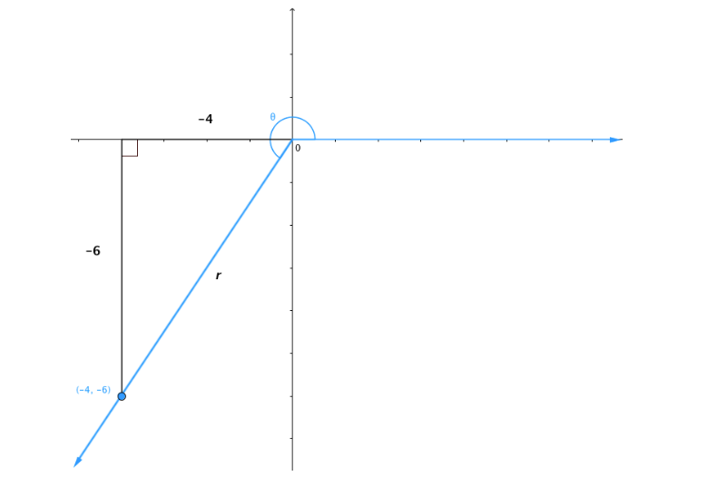

# AVP0469 — Single visual target

MathVista:23 / MathVerse:458 · different type · Mathematical roles of graphical elements

## Shared or similar visual information

A horizontal coordinate axis

## Evidence locations

- Left image: The horizontal axis below the V-shaped graph, with numbered ticks.
- Right image: The horizontal axis through the origin in the geometric angle construction.

## Mathematical meanings

Left image: The horizontal coordinate axis that locates graph positions by input coordinate. Right image: The horizontal coordinate axis that locates positions by x-coordinate.

## Same mathematical meanings

yes

## Rationales

The function plot and angle construction both locate points with the horizontal axis through the origin. This reference role is separate from the principal graph or ray.

Only the selected target is annotated. AI visual-review draft; not independently double-annotated by humans.
