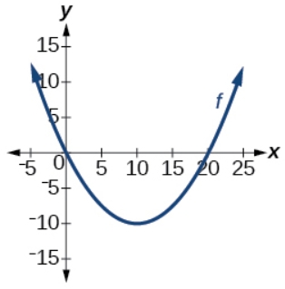

# AVP0471 — Single visual target

MathVista:409 / MathVerse:496 · different type · Mathematical roles of graphical elements

## Shared or similar visual information

An upright coordinate axis

## Evidence locations

- Left image: The upright black axis through the circle center, labeled y at the top.
- Right image: The upright numbered y-axis beside the U-shaped graph.

## Mathematical meanings

Left image: The vertical coordinate axis that locates positions by their y-coordinate. Right image: The vertical coordinate axis used to read graph output coordinates.

## Same mathematical meanings

yes

## Rationales

Both upright lines are y-coordinate references; the circle construction and function graph use them to locate vertical positions.

Only the selected target is annotated. AI visual-review draft; not independently double-annotated by humans.
