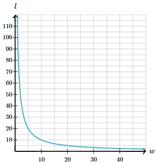

# AVP0472 — Single visual target

MathVista:767 / MathVerse:550 · different type · Mathematical roles of graphical elements

## Shared or similar visual information

An upright numbered coordinate axis

## Evidence locations

- Left image: The upright y-axis through the center of the coordinate circle.
- Right image: The upright numbered axis on the left of the decreasing curve.

## Mathematical meanings

Left image: The vertical coordinate axis that locates positions by their y-coordinate. Right image: The vertical coordinate axis used to read graph output coordinates.

## Same mathematical meanings

yes

## Rationales

The selected lines supply the vertical coordinate reference in each diagram. The surrounding shape and coordinate scales do not change this graphical role.

Only the selected target is annotated. AI visual-review draft; not independently double-annotated by humans.
