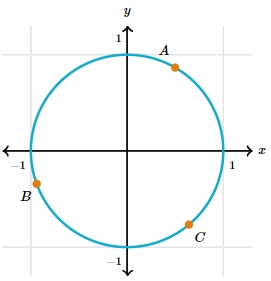

# AVP0473 — Single visual target

MathVista:137 / MathVerse:525 · different type · Mathematical roles of graphical elements

## Shared or similar visual information

An upright y-axis

## Evidence locations

- Left image: The upright numbered y-axis beside the parabola.
- Right image: The upright axis through the unit circle center, labeled y.

## Mathematical meanings

Left image: The vertical coordinate axis used to read graph output coordinates. Right image: The vertical coordinate axis that locates positions by their y-coordinate.

## Same mathematical meanings

yes

## Rationales

Each upright axis locates vertical coordinates; a parabola versus a unit-circle construction does not change the reference role.

Only the selected target is annotated. AI visual-review draft; not independently double-annotated by humans.
