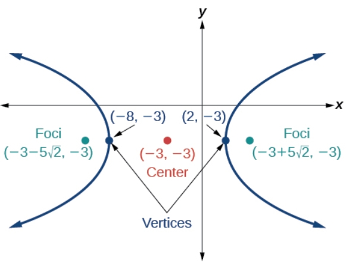

# AVP0474 — Single visual target

MathVista:369 / MathVerse:438 · different type · Mathematical roles of graphical elements

## Shared or similar visual information

An upright coordinate axis

## Evidence locations

- Left image: The upright numbered y-axis beside the cubic curve.
- Right image: The vertical coordinate axis in the annotated hyperbola diagram.

## Mathematical meanings

Left image: The vertical coordinate axis used to read graph output coordinates. Right image: The vertical coordinate axis that locates positions by their y-coordinate.

## Same mathematical meanings

yes

## Rationales

Both lines are vertical coordinate references passing through an origin in a Cartesian plane; they are not geometric altitudes or lengths.

Only the selected target is annotated. AI visual-review draft; not independently double-annotated by humans.
