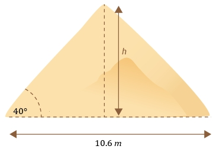

# AVP0475 — Single visual target

MathVista:273 / MathVerse:367 · different type · Mathematical roles of graphical elements

## Shared or similar visual information

A double-headed dimension arrow

## Evidence locations

- Left image: The horizontal double-headed dimension line below the blue diamond, labeled 2x.
- Right image: The horizontal double-headed arrow below the pyramid, labeled 10.6 m.

## Mathematical meanings

Left image: A spatial length annotation spanning the polygon width. Right image: A spatial length annotation spanning the pyramid base.

## Same mathematical meanings

yes

## Rationales

Each arrow sits outside the geometric object and spans a pair of boundary positions with a length label; it is a spatial dimension annotation in both cases.

Only the selected target is annotated. AI visual-review draft; not independently double-annotated by humans.
