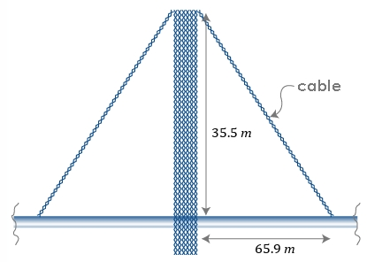

# AVP0476 — Single visual target

MathVista:310 / MathVerse:364 · same type · Mathematical roles of graphical elements

## Shared or similar visual information

A double-headed dimension arrow

## Evidence locations

- Left image: The sloping double-headed arrow outside and parallel to the triangle hypotenuse, labeled x.
- Right image: The horizontal double-headed arrow below the bridge, labeled 65.9 m.

## Mathematical meanings

Left image: A spatial length annotation spanning a side of the triangle. Right image: A spatial length annotation spanning two horizontal positions.

## Same mathematical meanings

yes

## Rationales

The arrows accompany geometric distance labels and indicate a finite spatial length, whether sloping along a triangle side or horizontal beneath a bridge.

Only the selected target is annotated. AI visual-review draft; not independently double-annotated by humans.
