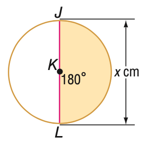
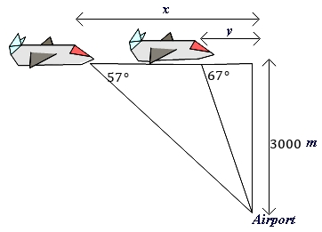

# AVP0477 — Single visual target

MathVista:250 / MathVerse:352 · same type · Mathematical roles of graphical elements

## Shared or similar visual information

An upright double-headed arrow

## Evidence locations

- Left image: The upright double-headed arrow to the right of the circle, labeled x cm.
- Right image: The upright double-headed arrow labeled 3000 m beside the airplane construction.

## Mathematical meanings

Left image: A spatial length annotation spanning the circle diameter. Right image: A spatial length annotation spanning the vertical distance to the airport.

## Same mathematical meanings

yes

## Rationales

The centimeter diameter and meter height are both finite spatial dimensions. Units and scene differ, but the selected arrows share the length-annotation function.

Only the selected target is annotated. AI visual-review draft; not independently double-annotated by humans.
