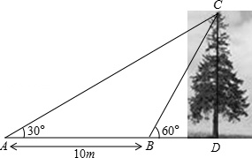
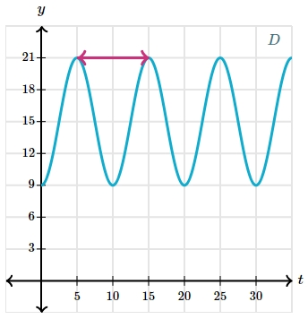

# AVP0478 — Single visual target

MathVista:523 / MathVerse:544 · different type · Mathematical roles of graphical elements

## Shared or similar visual information

A horizontal double-headed arrow

## Evidence locations

- Left image: The horizontal double-headed arrow below the ground segment between A and B, labeled 10 m.
- Right image: The magenta horizontal double-headed arrow between two adjacent waveform peaks.

## Mathematical meanings

Left image: A spatial length annotation spanning two ground positions. Right image: One horizontal-coordinate repetition interval of the waveform, namely its period.

## Same mathematical meanings

no

## Rationales

The 10 m arrow measures ground distance between A and B. The other spans adjacent peaks and identifies a repetition interval of the plotted waveform; it is not a geometric ground distance.

Only the selected target is annotated. AI visual-review draft; not independently double-annotated by humans.
