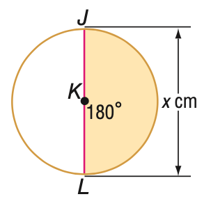
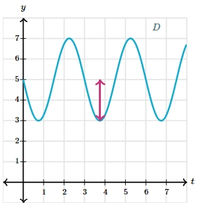

# AVP0480 — Single visual target

MathVista:250 / MathVerse:545 · different type · Mathematical roles of graphical elements

## Shared or similar visual information

An upright double-headed arrow

## Evidence locations

- Left image: The upright double-headed arrow to the right of the circle, labeled x cm.
- Right image: The magenta vertical double-headed arrow from the trough to the middle height of the waveform.

## Mathematical meanings

Left image: A spatial length annotation spanning the circle diameter. Right image: The vertical excursion from the waveform midlevel to a trough, representing its amplitude.

## Same mathematical meanings

no

## Rationales

The circle arrow measures a physical/geometric diameter in centimeters; the waveform arrow encodes amplitude relative to its middle level. The target quantities differ.

Only the selected target is annotated. AI visual-review draft; not independently double-annotated by humans.
