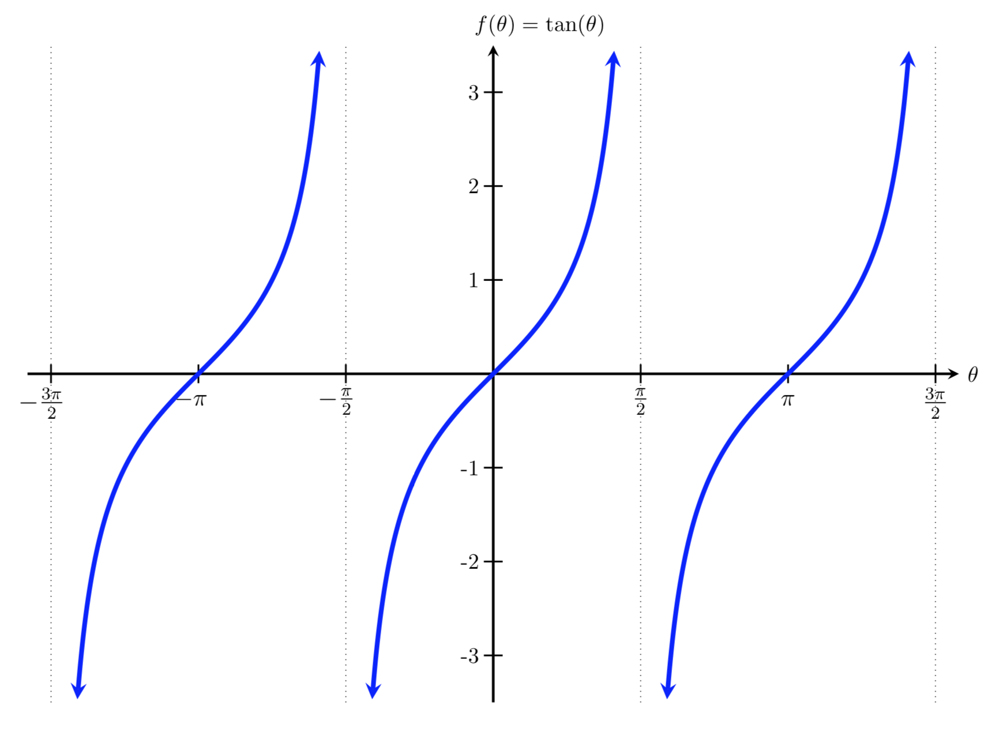
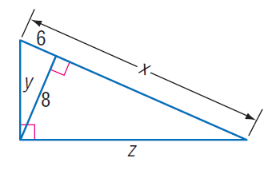

# AVP0481 — Single visual target

MathVista:661 / MathVista:310 · different type · Mathematical roles of graphical elements

## Shared or similar visual information

An arrowhead on a sloping or curved trace

## Evidence locations

- Left image: The arrowhead at the upper end of the central tangent-function branch.
- Right image: The sloping double-headed arrow outside and parallel to the triangle hypotenuse, labeled x.

## Mathematical meanings

Left image: Continuation of the function curve beyond the plotted window. Right image: A spatial length annotation spanning a side of the triangle.

## Same mathematical meanings

no

## Rationales

The function-branch arrow indicates continuation outside the display, while the arrow beside the triangle belongs to a bounded dimension line. It does not extend the triangle edge indefinitely.

Only the selected target is annotated. AI visual-review draft; not independently double-annotated by humans.
