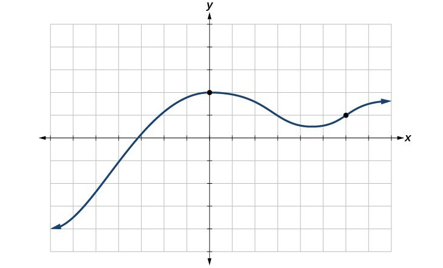
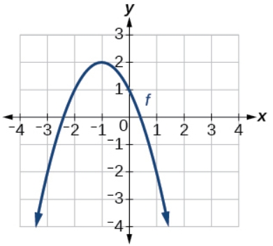

# AVP0482 — Single visual target

MathVista:686 / MathVerse:495 · same type · Mathematical roles of graphical elements

## Shared or similar visual information

An arrowhead at the end of a plotted curve

## Evidence locations

- Left image: The arrowhead at the right end of the blue curve.
- Right image: The arrowhead at the lower-right end of the parabola.

## Mathematical meanings

Left image: Continuation of the function curve beyond the plotted window. Right image: Continuation of the function curve beyond the plotted window.

## Same mathematical meanings

yes

## Rationales

Both arrowheads occur on the curve itself at the display boundary and signal continuation beyond the visible window, rather than endpoint inclusion or a length measurement.

Only the selected target is annotated. AI visual-review draft; not independently double-annotated by humans.
