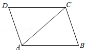
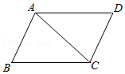

# AVP0483 — Single visual target

MathVista:32 / MathVista:179 · same type · Mathematical roles of graphical elements

## Shared or similar visual information

A straight segment inside a four-sided figure

## Evidence locations

- Left image: The straight segment from A to C inside quadrilateral ABCD.
- Right image: The straight segment joining A and C across parallelogram ABCD.

## Mathematical meanings

Left image: A diagonal connecting nonadjacent vertices of a geometric quadrilateral. Right image: A diagonal connecting nonadjacent vertices of a geometric quadrilateral.

## Same mathematical meanings

yes

## Rationales

Both selected segments join opposite named vertices, so their common role is a quadrilateral diagonal rather than a boundary side.

Only the selected target is annotated. AI visual-review draft; not independently double-annotated by humans.
