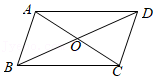
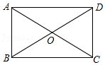

# AVP0484 — Single visual target

MathVista:486 / MathVista:585 · same type · Mathematical roles of graphical elements

## Shared or similar visual information

A straight segment through the interior of a quadrilateral

## Evidence locations

- Left image: The segment from A to C through O inside the quadrilateral.
- Right image: The segment from A to C through O inside the rectangle.

## Mathematical meanings

Left image: A diagonal connecting nonadjacent vertices of a geometric quadrilateral. Right image: A diagonal connecting nonadjacent vertices of a geometric quadrilateral.

## Same mathematical meanings

yes

## Rationales

In each image the segment connects nonadjacent vertices and intersects another diagonal; this is the same geometric diagonal role.

Only the selected target is annotated. AI visual-review draft; not independently double-annotated by humans.
