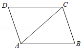

# AVP0485 — Single visual target

MathVista:32 / MathVista:137 · different type · Mathematical roles of graphical elements

## Shared or similar visual information

A straight segment inside a diagram

## Evidence locations

- Left image: The straight segment from A to C inside quadrilateral ABCD.
- Right image: The upper orange horizontal line cutting the graph f(x)=x^2.

## Mathematical meanings

Left image: A diagonal connecting nonadjacent vertices of a geometric quadrilateral. Right image: A fixed-y horizontal comparison line across the function graph.

## Same mathematical meanings

no

## Rationales

The first segment connects opposite vertices of a finite quadrilateral. The second is a constant-y guide crossing a function curve; it is not a polygon diagonal.

Only the selected target is annotated. AI visual-review draft; not independently double-annotated by humans.
