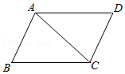

# AVP0486 — Single visual target

MathVista:179 / MathVista:369 · different type · Mathematical roles of graphical elements

## Shared or similar visual information

A straight line segment inside a diagram

## Evidence locations

- Left image: The straight segment joining A and C across parallelogram ABCD.
- Right image: The upper orange horizontal line cutting the graph f(x)=x^3.

## Mathematical meanings

Left image: A diagonal connecting nonadjacent vertices of a geometric quadrilateral. Right image: A fixed-y horizontal comparison line across the function graph.

## Same mathematical meanings

no

## Rationales

The geometric segment joins A to C as a diagonal, while the orange horizontal segment compares a function graph against a selected y-level.

Only the selected target is annotated. AI visual-review draft; not independently double-annotated by humans.
