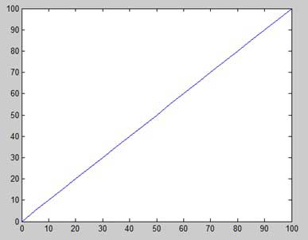
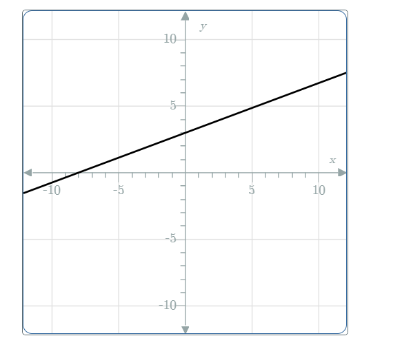

# AVP0487 — Single visual target

MathVista:962 / MathVerse:507 · same type · Mathematical roles of graphical elements

## Shared or similar visual information

A solid straight line rising from left to right.

## Evidence locations

- Left image: The rising trace through the origin from the lower-left to the upper-right of the plot.
- Right image: The black straight line crossing the axes and rising to the right.

## Mathematical meanings

Left image: The trace represents a linear relation assigning equal coordinates along the trace. Right image: The line is the graph of a positive-slope linear function.

## Same mathematical meanings

yes

## Rationales

In both images the feature plots a linear relationship between coordinates. The rising trace through the origin from the lower-left to the upper-right of the plot. The black straight line crossing the axes and rising to the right.

Only the selected target is annotated. AI visual-review draft; not independently double-annotated by humans.
