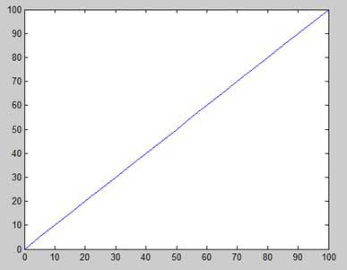
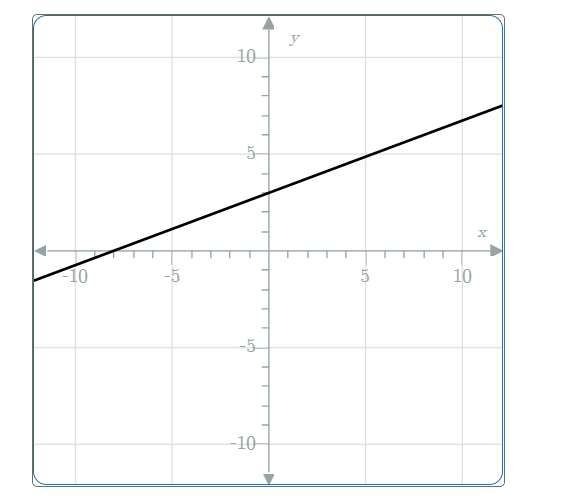

# AVP0487 — Single visual target

MathVista:962 / MathVerse:507 · same type · Mathematical roles of graphical elements

## Shared or similar visual information

A straight line across a coordinate plot

## Evidence locations

- Left image: The straight increasing trace across the plotted x-y square.
- Right image: The straight rising black line across the coordinate grid.

## Mathematical meanings

Left image: A straight-line graph representing a variable relationship. Right image: A straight-line graph representing a variable relationship.

## Same mathematical meanings

yes

## Rationales

Both traces encode an input-output relation by Cartesian positions. The comparison concerns their function-graph role, without asserting equal slopes or intercepts.

Only the selected target is annotated. AI visual-review draft; not independently double-annotated by humans.
