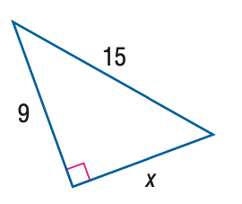
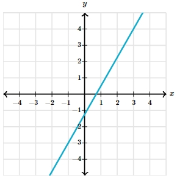

# AVP0488 — Single visual target

MathVista:160 / MathVerse:592 · different type · Mathematical roles of graphical elements

## Shared or similar visual information

A straight line sloping upward or downward across a diagram

## Evidence locations

- Left image: The sloping blue side marked 15 in the triangle.
- Right image: The cyan straight line rising across the coordinate grid.

## Mathematical meanings

Left image: A boundary side of a geometric triangle, carrying a length annotation. Right image: A straight-line graph representing a variable relationship.

## Same mathematical meanings

no

## Rationales

The length-labeled stroke bounds a finite triangle; the other stroke extends through Cartesian positions to express a variable relationship.

Only the selected target is annotated. AI visual-review draft; not independently double-annotated by humans.
