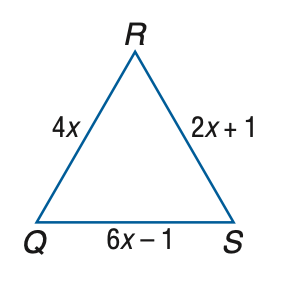
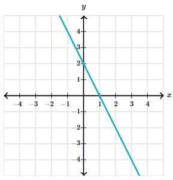

# AVP0489 — Single visual target

MathVista:176 / MathVerse:591 · different type · Mathematical roles of graphical elements

## Shared or similar visual information

A straight sloping line

## Evidence locations

- Left image: The sloping blue side QR marked 4x.
- Right image: The cyan straight line descending across the coordinate grid.

## Mathematical meanings

Left image: A boundary side of a geometric triangle, carrying a length annotation. Right image: A straight-line graph representing a variable relationship.

## Same mathematical meanings

no

## Rationales

The side QR is a finite edge with an algebraic length label. The coordinate-plane line is a function graph, not a side of a triangle.

Only the selected target is annotated. AI visual-review draft; not independently double-annotated by humans.
