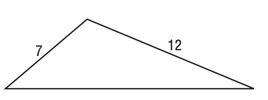
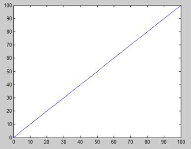

# AVP0490 — Single visual target

MathVista:615 / MathVista:962 · different type · Mathematical roles of graphical elements

## Shared or similar visual information

A straight sloping line

## Evidence locations

- Left image: The sloping triangle side marked 12.
- Right image: The straight increasing trace across the plotted x-y square.

## Mathematical meanings

Left image: A boundary side of a geometric triangle, carrying a length annotation. Right image: A straight-line graph representing a variable relationship.

## Same mathematical meanings

no

## Rationales

The segment labeled 12 is part of a triangle boundary. The rising trace across numbered axes represents a variable correspondence. Matching straightness is insufficient for semantic equality.

Only the selected target is annotated. AI visual-review draft; not independently double-annotated by humans.
