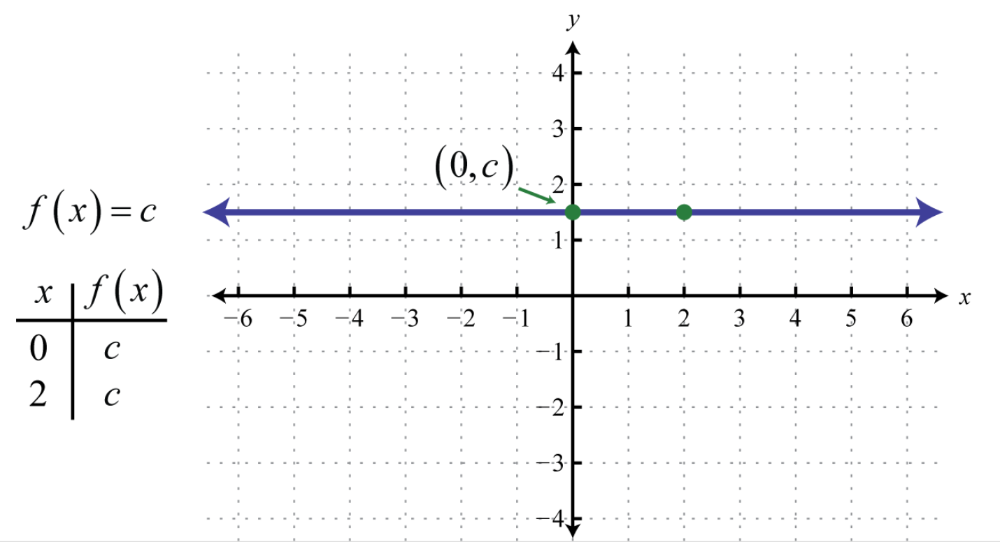
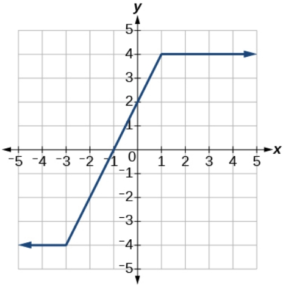

# AVP0491 — Single visual target

MathVista:223 / MathVerse:501 · same type · Mathematical roles of graphical elements

## Shared or similar visual information

A horizontal plotted trace

## Evidence locations

- Left image: The purple horizontal trace labeled f(x)=c with arrows at both ends.
- Right image: The upper horizontal dark-blue ray at y=4.

## Mathematical meanings

Left image: A constant function graph: the output remains c as the horizontal input varies. Right image: A constant-output part of the displayed piecewise function graph.

## Same mathematical meanings

yes

## Rationales

Both selected horizontal traces keep the function output constant across a horizontal interval; the first is a whole constant function and the second a piece of one.

Only the selected target is annotated. AI visual-review draft; not independently double-annotated by humans.
