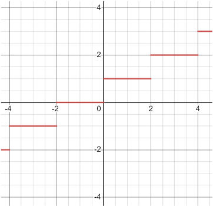
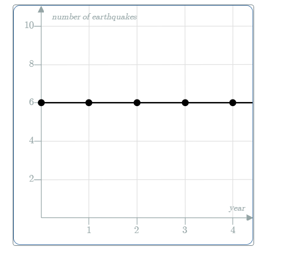

# AVP0492 — Single visual target

MathVista:720 / MathVerse:610 · same type · Mathematical roles of graphical elements

## Shared or similar visual information

A horizontal plotted segment

## Evidence locations

- Left image: The red horizontal segment between x=2 and x=4 at height 2.
- Right image: The horizontal black trace through five filled points at height 6.

## Mathematical meanings

Left image: A constant-output piece of a step-function graph over a horizontal input interval. Right image: A constant-output graph: the plotted count stays at the same level over the shown years.

## Same mathematical meanings

yes

## Rationales

Both traces hold the output at one fixed level over the selected input span. Their measured variables and heights differ, but constant-output representation is shared.

Only the selected target is annotated. AI visual-review draft; not independently double-annotated by humans.
