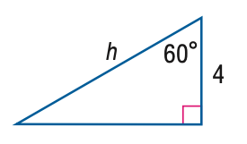
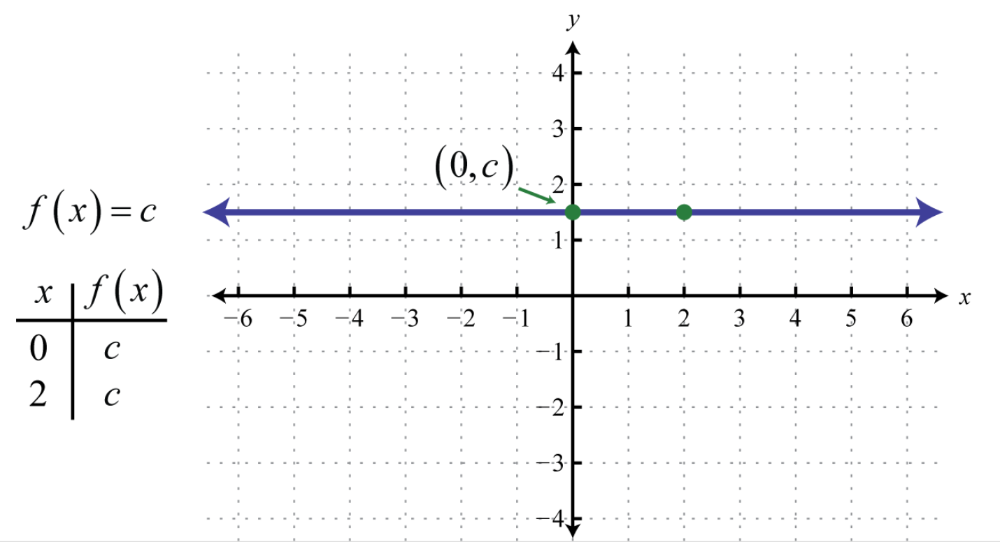

# AVP0493 — Single visual target

MathVista:665 / MathVista:223 · different type · Mathematical roles of graphical elements

## Shared or similar visual information

A horizontal straight line

## Evidence locations

- Left image: The lower horizontal blue side of the right triangle.
- Right image: The purple horizontal trace labeled f(x)=c with arrows at both ends.

## Mathematical meanings

Left image: A boundary edge of a finite geometric triangle. Right image: A constant function graph: the output remains c as the horizontal input varies.

## Same mathematical meanings

no

## Rationales

The first is a finite boundary edge of a triangle. The second is explicitly f(x)=c and represents constant function output as x varies.

Only the selected target is annotated. AI visual-review draft; not independently double-annotated by humans.
