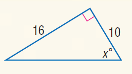
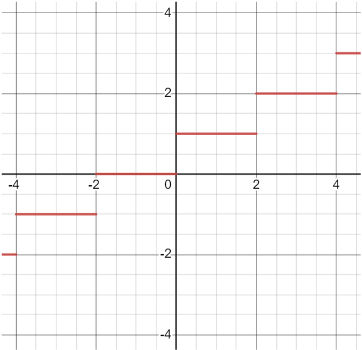

# AVP0494 — Single visual target

MathVista:678 / MathVista:720 · different type · Mathematical roles of graphical elements

## Shared or similar visual information

A horizontal straight segment

## Evidence locations

- Left image: The lower horizontal blue side of the triangle.
- Right image: The red horizontal segment between x=2 and x=4 at height 2.

## Mathematical meanings

Left image: A boundary edge of a finite geometric triangle. Right image: A constant-output piece of a step-function graph over a horizontal input interval.

## Same mathematical meanings

no

## Rationales

The blue segment closes a geometric triangle; the red segment is a constant-output portion of a step graph on Cartesian axes.

Only the selected target is annotated. AI visual-review draft; not independently double-annotated by humans.
