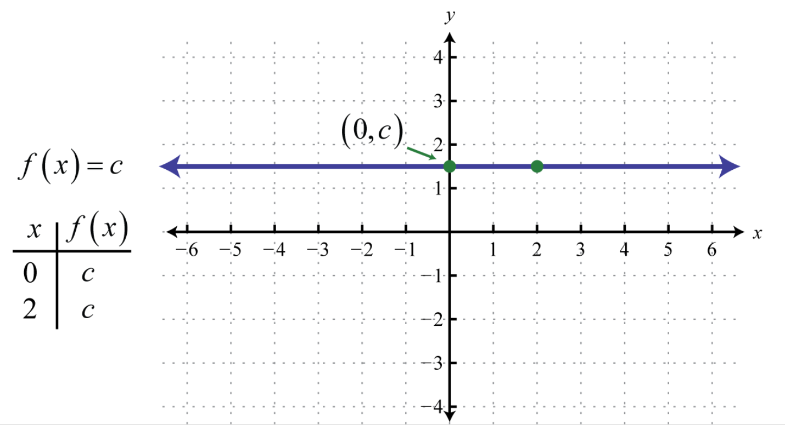

# AVP0495 — Single visual target

MathVista:137 / MathVista:223 · same type · Mathematical roles of graphical elements

## Shared or similar visual information

A horizontal colored line in a function diagram

## Evidence locations

- Left image: The upper orange horizontal line cutting the graph f(x)=x^2.
- Right image: The purple horizontal trace labeled f(x)=c with arrows at both ends.

## Mathematical meanings

Left image: A fixed-y horizontal comparison line across the function graph. Right image: A constant function graph: the output remains c as the horizontal input varies.

## Same mathematical meanings

no

## Rationales

The orange stroke is one of several fixed-height guides cutting the parabola; the purple trace is explicitly labeled f(x)=c and is itself the function being plotted.

Only the selected target is annotated. AI visual-review draft; not independently double-annotated by humans.
