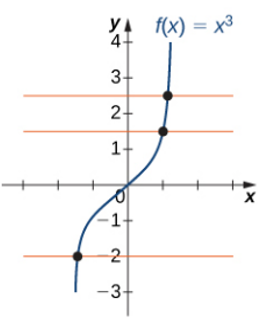
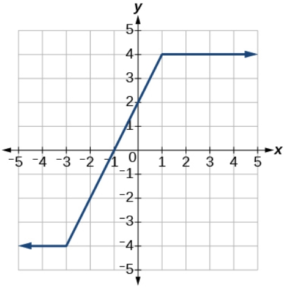

# AVP0496 — Single visual target

MathVista:369 / MathVerse:501 · same type · Mathematical roles of graphical elements

## Shared or similar visual information

A horizontal colored line in a function diagram

## Evidence locations

- Left image: The upper orange horizontal line cutting the graph f(x)=x^3.
- Right image: The upper horizontal dark-blue ray at y=4.

## Mathematical meanings

Left image: A fixed-y horizontal comparison line across the function graph. Right image: A constant-output part of the displayed piecewise function graph.

## Same mathematical meanings

no

## Rationales

The orange line supports level comparison with the cubic curve, while the dark-blue ray is part of the principal piecewise function graph. A guide and the represented function have different roles.

Only the selected target is annotated. AI visual-review draft; not independently double-annotated by humans.
