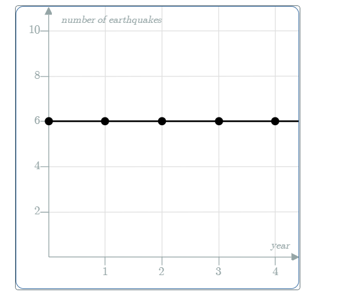

# AVP0497 — Single visual target

MathVista:592 / MathVerse:610 · same type · Mathematical roles of graphical elements

## Shared or similar visual information

A horizontal line across a coordinate plot

## Evidence locations

- Left image: The orange horizontal dashed line crossing the oscillating curve above the x-axis.
- Right image: The horizontal black trace through five filled points at height 6.

## Mathematical meanings

Left image: A fixed-height reference line in the coordinate system. Right image: A constant-output graph: the plotted count stays at the same level over the shown years.

## Same mathematical meanings

no

## Rationales

The dashed orange line is a reference level for the oscillating graph; the solid line through the observations represents the constant earthquake count itself.

Only the selected target is annotated. AI visual-review draft; not independently double-annotated by humans.
