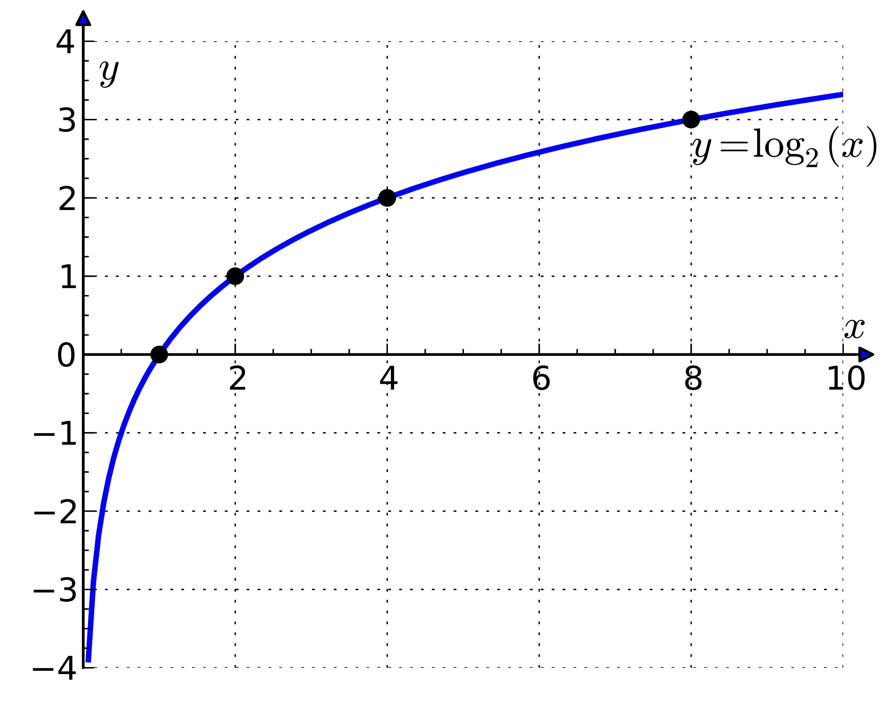

# AVP0498 — Single visual target

MathVista:310 / MathVista:329 · different type · Mathematical roles of graphical elements

## Shared or similar visual information

An arrowhead on a line

## Evidence locations

- Left image: The sloping double-headed arrow outside and parallel to the triangle hypotenuse, labeled x.
- Right image: The horizontal x-axis under the logarithmic curve, with numbered ticks.

## Mathematical meanings

Left image: A spatial length annotation spanning a side of the triangle. Right image: The horizontal coordinate axis that locates graph positions by input coordinate.

## Same mathematical meanings

no

## Rationales

The arrowheads outside the triangle bound a finite side-length dimension; the arrow on the logarithmic plot belongs to the horizontal coordinate axis and indicates its orientation.

Only the selected target is annotated. AI visual-review draft; not independently double-annotated by humans.
