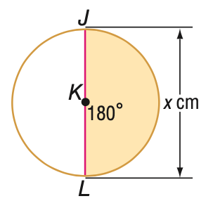

# AVP0499 — Single visual target

MathVista:250 / MathVerse:493 · different type · Mathematical roles of graphical elements

## Shared or similar visual information

An arrowhead on a straight line

## Evidence locations

- Left image: The upright double-headed arrow to the right of the circle, labeled x cm.
- Right image: The horizontal black x-axis crossing the V-shaped graph.

## Mathematical meanings

Left image: A spatial length annotation spanning the circle diameter. Right image: The horizontal coordinate axis used to read graph input coordinates.

## Same mathematical meanings

no

## Rationales

The arrow beside x cm participates in a bounded diameter measurement. The coordinate-axis arrow sets a reference direction rather than specifying a finite length interval.

Only the selected target is annotated. AI visual-review draft; not independently double-annotated by humans.
