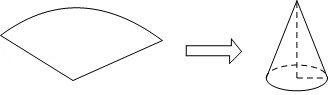
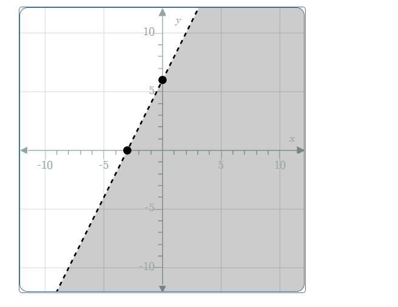

# AVP0500 — Single visual target

MathVista:33 / MathVerse:511 · different type · Mathematical roles of graphical elements

## Shared or similar visual information

A broken or dashed line

## Evidence locations

- Left image: The dashed curved arc at the back of the cone base.
- Right image: The gray half-plane on one side of the rising dashed line.

## Mathematical meanings

Left image: A hidden portion of the circular base edge in a three-dimensional cone drawing. Right image: A coordinate-plane solution region of a linear inequality; the dashed boundary is excluded.

## Same mathematical meanings

no

## Rationales

The cone dashes represent an occluded rear edge of a three-dimensional object. The dashed straight boundary of the gray half-plane instead indicates exclusion from an inequality solution set.

Only the selected target is annotated. AI visual-review draft; not independently double-annotated by humans.
