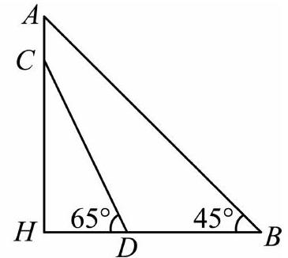

# AVP0501 — Single visual target

MV-MATH:1854_2 / MathVerse:439 · same type · Numeric representation and conversion

## Shared or similar visual information

The numerical notations 45° and π/4.

## Evidence locations

- Left image: The 45° inside the lower-right vertex B of triangle ABH.
- Right image: The π/4 printed inside the angle arc at the origin of the quarter-circle diagram.

## Mathematical meanings

Left image: The angle between BA and BH at B measures 45 degrees. Right image: The indicated angle measures π/4 radians.

## Same mathematical meanings

yes

## Rationales

π/4 radians equals 45 degrees. The two labels both measure an angle.

Only the selected target is annotated. AI visual-review draft; not independently double-annotated by humans.
