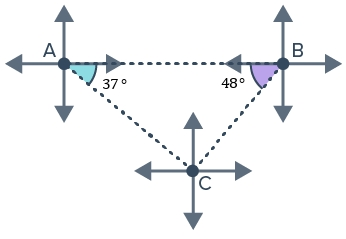
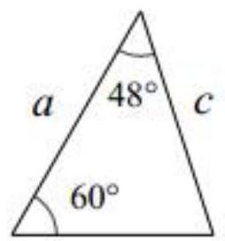

# AVP0502 — Single visual target

MathVerse:337 / MV-MATH:973_1 · same type · Numeric representation and conversion

## Shared or similar visual information

The numerical notation 48° in both images.

## Evidence locations

- Left image: The 48° in the purple angle region at B.
- Right image: The 48° beneath the arc at the apex of the triangle.

## Mathematical meanings

Left image: The marked angle at B measures 48 degrees. Right image: The marked apex angle measures 48 degrees.

## Same mathematical meanings

yes

## Rationales

Both labels are attached to marked angle regions and give the same measure of 48°.

Only the selected target is annotated. AI visual-review draft; not independently double-annotated by humans.
