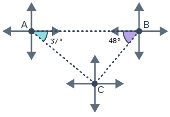
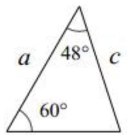

# AVP0502 — Single visual target

MathVerse:337 / MV-MATH:973_1 · same type · Numeric representation and conversion

## Shared or similar visual information

The numerical notation 48°.

## Evidence locations

- Left image: The notation 48° appears next to the purple wedge at B.
- Right image: The notation 48° appears next to the arc at the top of the triangle.

## Mathematical meanings

Left image: 48° measures the bearing offset between the westward horizontal ray and BC. Right image: 48° measures the interior angle at the top vertex.

## Same mathematical meanings

yes

## Rationales

Each notation is placed next to the marked angle and specifies the same angle measure of 48°.

Only the selected target is annotated. AI visual-review draft; not independently double-annotated by humans.
