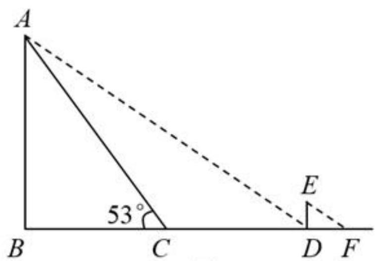
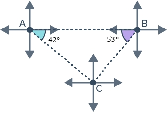

# AVP0503 — Single visual target

MV-MATH:1905_2 / MathVerse:341 · same type · Numeric representation and conversion

## Shared or similar visual information

The numerical notation 53°.

## Evidence locations

- Left image: The notation 53° appears beside the arc at C.
- Right image: The notation 53° appears beside the purple wedge at B.

## Mathematical meanings

Left image: 53° measures the marked angle between CA and CB. Right image: 53° measures the angle between the westward ray and BC.

## Same mathematical meanings

yes

## Rationales

Each notation is placed next to the marked angle and specifies the same angle measure of 53°.

Only the selected target is annotated. AI visual-review draft; not independently double-annotated by humans.
