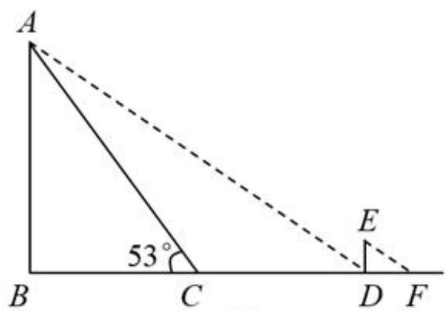
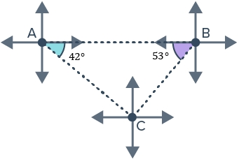

# AVP0503 — Single visual target

MV-MATH:1905_2 / MathVerse:341 · same type · Numeric representation and conversion

## Shared or similar visual information

The numerical notation 53° in both images.

## Evidence locations

- Left image: The 53° at C on the left side of sloping segment CA.
- Right image: The 53° in the purple angle region at B.

## Mathematical meanings

Left image: The angle between CB and CA at C measures 53 degrees. Right image: The marked angle at B measures 53 degrees.

## Same mathematical meanings

yes

## Rationales

Both labels are attached to marked angle regions and give the same measure of 53°.

Only the selected target is annotated. AI visual-review draft; not independently double-annotated by humans.
