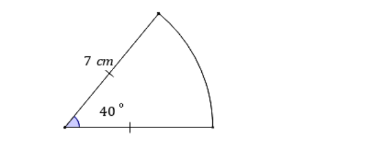
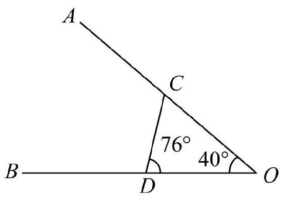

# AVP0504 — Single visual target

MathVerse:408 / MV-MATH:1830_2 · same type · Numeric representation and conversion

## Shared or similar visual information

The numerical notation 40°.

## Evidence locations

- Left image: The notation 40° appears next to the shaded wedge at the sector vertex.
- Right image: The notation 40° appears beside the arc at O.

## Mathematical meanings

Left image: 40° measures the angle between the sector radii. Right image: 40° gives the measure of the angle between the horizontal ray toward D and the slanted ray toward C.

## Same mathematical meanings

yes

## Rationales

Each notation is placed next to the marked angle and specifies the same angle measure of 40°.

Only the selected target is annotated. AI visual-review draft; not independently double-annotated by humans.
