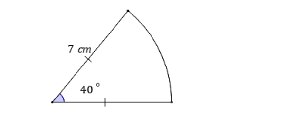
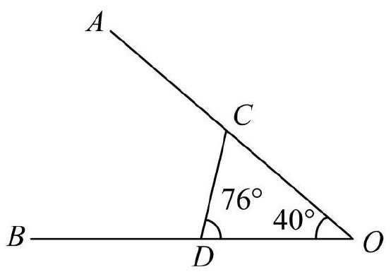

# AVP0504 — Single visual target

MathVerse:408 / MV-MATH:1830_2 · same type · Numeric representation and conversion

## Shared or similar visual information

The numerical notation 40° in both images.

## Evidence locations

- Left image: The 40° beside the arc at the lower-left vertex of the sector.
- Right image: The 40° inside the small triangular region at O.

## Mathematical meanings

Left image: The indicated central angle measures 40 degrees. Right image: The angle between OD and OC at O measures 40 degrees.

## Same mathematical meanings

yes

## Rationales

Both labels are attached to marked angle regions and give the same measure of 40°.

Only the selected target is annotated. AI visual-review draft; not independently double-annotated by humans.
