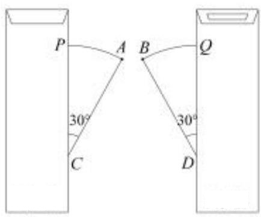
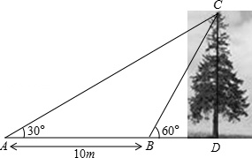

# AVP0505 — Single visual target

MV-MATH:847_2 / MathVista:523 · same type · Numeric representation and conversion

## Shared or similar visual information

The numerical notation 30° in both images.

## Evidence locations

- Left image: The 30° beside C between the left vertical gate edge and segment CA.
- Right image: The 30° above A at the left end of the horizontal ground line.

## Mathematical meanings

Left image: The angle between the left vertical direction and CA at C measures 30 degrees. Right image: The angle between AC and the ground ray at A measures 30 degrees.

## Same mathematical meanings

yes

## Rationales

Both labels are attached to marked angle regions and give the same measure of 30°.

Only the selected target is annotated. AI visual-review draft; not independently double-annotated by humans.
