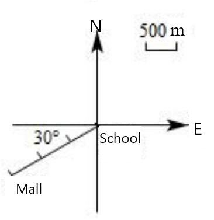
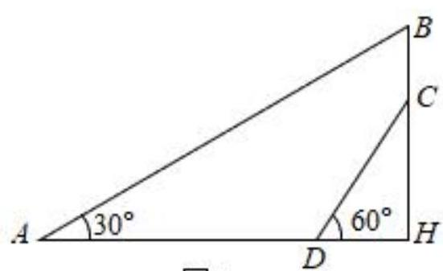

# AVP0506 — Single visual target

MV-MATH:359_1 / MV-MATH:1874_2 · same type · Numeric representation and conversion

## Shared or similar visual information

The numerical notation 30° in both images.

## Evidence locations

- Left image: The 30° inside the angle below the leftward horizontal ray from School.
- Right image: The 30° next to the arc at the leftmost point A.

## Mathematical meanings

Left image: The marked angle between the westward reference ray and the route toward Mall measures 30 degrees. Right image: The angle between AH and AB at A measures 30 degrees.

## Same mathematical meanings

yes

## Rationales

Both labels are attached to marked angle regions and give the same measure of 30°.

Only the selected target is annotated. AI visual-review draft; not independently double-annotated by humans.
